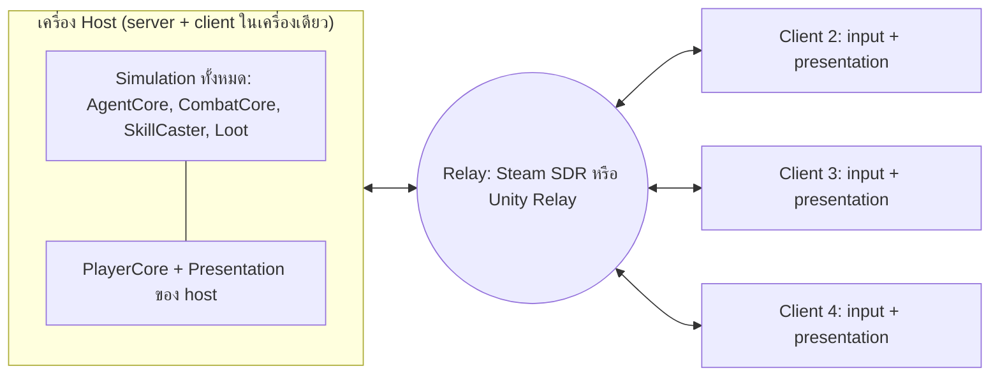

# การวิเคราะห์ Online Co-op: Dedicated Server เทียบกับ P2P (Pale Vertica)

- **สถานะ:** เอกสารวิเคราะห์เท่านั้น ยังไม่มีการเขียนโค้ด network ใด ๆ
- **ตรวจกับโค้ดล่าสุดเมื่อ:** 2026-10-28 (Unity 6000.4.8f1) รวมงาน combat ที่ยังไม่ commit (ASPD แบบเปอร์เซ็นต์, DoubleAttack / DoubleSpell, Echo Spell ผ่าน `SkillPayload.DamageMultiplier`, `IsRepeatCast`)
- **ราคาและสถานะของบริการภายนอก:** ค้นจากเว็บเมื่อ 2026-10-28 (ดูแหล่งอ้างอิงท้ายเอกสาร) ตรวจราคาอีกครั้งก่อนตั้งงบจริง
- path ของไฟล์ทั้งหมดอ้างจาก `Assets/Script/` เว้นแต่จะระบุเป็นอย่างอื่น

---

## 0. สมมติฐานที่ใช้ในเอกสารนี้

ตัวเลขและคำแนะนำทั้งหมดตั้งอยู่บนสมมติฐานต่อไปนี้ ถ้าข้อใดไม่ตรง คำตอบอาจเปลี่ยน (ดูคำถามที่ข้อ 7.4)

| หัวข้อ | สมมติฐาน |
|---|---|
| ขนาดปาร์ตี้ | 2-4 คน ต่อ 1 session |
| รูปแบบการเล่น | PvE co-op เท่านั้น ไม่มี PvP |
| โลกของเกม | เป็นแบบ instance: ปาร์ตี้เข้าแมพหรือดันเจี้ยนด้วยกัน ไม่ใช่โลกถาวรแบบ MMO |
| แพลตฟอร์ม | PC ก่อน (น่าจะขายบน Steam) ยังไม่คิดเรื่อง crossplay หรือ console |
| ผู้เล่นหลัก | ไทย / เอเชียตะวันออกเฉียงใต้ ใช้ region สิงคโปร์ |
| ตัวละคร | แต่ละคนนำตัวละครจาก save ของตัวเองเข้ามา |
| Single-player | ยังต้องเล่น offline ได้เหมือนเดิม |
| ทีม | โปรแกรมเมอร์ 1-2 คน ประมาณเวลาเป็น "สัปดาห์-คน" ของนักพัฒนา Unity ที่เคยทำ netcode มาก่อน ถ้ายังไม่เคย ให้คูณประมาณ 1.5-2 |
| Traffic ต่อผู้เล่น | ประมาณขาลง 8 KB/s และขาขึ้น 2 KB/s (ช่วงที่เป็นไปได้ 5-15 KB/s) สำหรับผู้เล่น 4 คนกับศัตรูราว 20-30 ตัวที่ 20 Hz ต้องวัดจริงใน prototype |

---

## 1. สรุปสั้นและคำตัดสิน

**คำตอบสั้น:** ทำ co-op ได้ และไม่ต้องรื้อระบบหลัก เพราะโค้ดมีรอยต่อที่ดีอยู่แล้ว (คำสั่งทุกอย่างผ่าน `ControlSystem`, damage ทุกก้อนผ่าน `CombatCore`, random ของ combat ผ่าน `ICombatRandom`) แต่ยังต้องทำงานฐานก่อนราว 6-9 สัปดาห์-คน เพื่อแยก simulation ออกจาก presentation และเลิกสมมติว่ามีผู้เล่นคนเดียว

**แนวทางที่แนะนำ:** เขียนเกมแบบ "server เป็นผู้ตัดสิน" (server-authoritative) แต่ช่วงแรกให้รันแบบ **listen server** คือผู้เล่นคนหนึ่งเป็น host และคนอื่นต่อผ่าน relay พอวันหนึ่งต้องการ dedicated server ก็ใช้โค้ดชุดเดียวกันรันแบบ headless ได้ งานราว 70% ใช้ร่วมกันทั้งสองแบบ

### คะแนนความเหมาะสม (10 = ใช้กับโค้ดตอนนี้ได้แทบไม่ต้องแก้)

| รูปแบบ | คะแนน | เหตุผลหลัก |
|---|---|---|
| **P2P: listen server (host เป็นผู้ตัดสิน) + relay** | **8/10** | ปาร์ตี้ 2-4 คนที่เป็นเพื่อนกัน, ค่าใช้จ่ายรายเดือนต่ำมาก (Steam relay ฟรี, Unity Relay ฟรีถึง 50 CCU เฉลี่ย), `CombatCore` รันที่เครื่องเดียวตามที่ออกแบบไว้, ต่อยอดเป็น dedicated ได้ ข้อเสีย: host ได้เปรียบเรื่อง ping, host โกงได้, host ออกแล้ว session จบ |
| **Dedicated server (Unity headless build)** | **6/10** (ตอนนี้) | ทางเทคนิคเหมาะ (7/10) แต่ค่าใช้จ่ายและงานดูแลสูงเกินไปสำหรับ co-op 2-4 คนในช่วงแรก (4/10) คุ้มเมื่อมีระบบเทรด ตลาด อันดับ หรือตัวละครที่ต้องเก็บบน server เพื่อกันโกง |
| Distributed authority / shared mode (แต่ละเครื่องเป็นเจ้าของ object ของตัวเอง) | 4/10 | ทำ prototype ได้เร็ว แต่ขัดกับ `CombatCore` ที่ออกแบบให้ resolve ที่เครื่องเดียว: hook ฝั่งผู้ตี (`TriggerOnHit`) กับฝั่งผู้โดน (`TriggerOnTakeDamage`) จะไปรันคนละเครื่อง และโกงง่าย |
| Deterministic lockstep | 2/10 | ไม่สมจริง: ใช้ float ทุกที่, ใช้ `Physics2D`, `Time.deltaTime` ที่ไม่คงที่, coroutine `WaitForSeconds`, Addressables แบบ async ต้องเขียนแกนเกมใหม่ทั้งหมด และ ARPG ที่มีศัตรูราว 30 ตัวไม่ได้ประโยชน์จาก lockstep (ดูข้อ 4.9) |

### ความพร้อมของโค้ดเบสโดยรวม: ปานกลาง (5/10)

| ส่วน | ความพร้อม | หมายเหตุ |
|---|---|---|
| Input เป็น Command | สูง | `ControlSystem.Command*` ใช้ทั้ง `PlayerCore` และ `AgentCore` |
| คณิตศาสตร์ combat | สูง | `Combat/Formulas/` เป็น pure function, `CombatCore.Resolve` ไม่มี side effect |
| การ commit ผลของ combat | ปานกลาง | `DamageHandler.Commit` ยังเรียก damage text กับ hit VFX เอง |
| Random | ปานกลาง | crit กับ rider ผ่าน `ICombatRandom` แล้ว แต่ passive / refine / spawner / AI ยังเรียก `UnityEngine.Random` ตรง ๆ |
| ID ของ entity | ปานกลาง | มี `CharacterRegistry` แต่ `RuntimeId` เป็นตัวนับของแต่ละเครื่อง |
| AI | สูง | หาเป้าหมายด้วย faction ไม่ได้ผูกกับ "ผู้เล่นคนนั้น" ให้รันบน server อย่างเดียวได้เลย |
| การร่ายสกิล | ปานกลาง | ผูกกับ indicator และ hotbar แบบ global, การร่ายซ้ำใช้ coroutine |
| Buff | ปานกลาง | เป็น plain class ส่งเป็นรายการสั้น ๆ ได้ |
| Projectile | ต่ำถึงปานกลาง | MonoBehaviour ที่โดนผ่าน trigger ของ physics |
| ข้อมูลผู้เล่น / save / inventory | ต่ำ | `GameData.Player` เป็น static ของผู้เล่นคนเดียว |
| UI | สูง | ฟัง event ของ "ผู้เล่นในเครื่องนี้" ซึ่งยังมีคนเดียวต่อเครื่องเหมือนเดิม |
| Scene / session flow | ต่ำ | build มีแค่ `Assets/Scenes/SandBox.unity` ไม่มีเมนู ไม่มีหน้าเลือกตัว |

---

## 2. สถาปัตยกรรมตอนนี้ในมุมของ networking

### 2.1 สิ่งที่ช่วยให้ทำ network ได้ง่ายขึ้น

1. **Command seam ที่ชัดเจน.** ทุกการกระทำของตัวละครผ่าน `CoreSystem/Entity/ControlSystem.cs:129-163` (`CommandMove`, `CommandBasicAttack`, `CommandCastSkill`, `CommandInterruptCast`) `PlayerCore` แปลง input เป็นคำสั่งเหล่านี้ และ `AgentHandle` ก็ใช้ชุดเดียวกัน ฝั่ง network แค่เพิ่ม controller ใหม่ที่รับคำสั่งจากสายเน็ตแล้วเรียก method เดิม ระบบ lease (`ControlLane.Owner/Scripted/Possession/Dev` ใน `CharacterTypes.cs`) ก็เป็นโมเดลของ "ใครมีสิทธิ์สั่ง" อยู่แล้ว
2. **ร่างกายแยกจากสมอง.** `Character` เป็นคลาสร่างกายคลาสเดียว ส่วนคนขับคือ `CharacterControllerType` (Player / Agent) และ `CharacterFactory.AssignController` (`CoreSystem/Entity/CharacterFactory.cs:37-50`) การเพิ่มชนิด `Remote` เป็นงานเล็ก และตรงกับแบบที่ netcode ทุกตัวต้องการ
3. **คำนวณแยกจากการ apply.** `CombatCore.Resolve` ไม่มี side effect และ `OutcomeApplier.Apply` เป็นที่เดียวที่ HP เปลี่ยน (`CoreSystem/Combat/CombatCore.cs`, `Combat/Apply/OutcomeApplier.cs`) `Outcome` (source, target, attribute, amount, isCritical) เป็นข้อความ network ตามธรรมชาติอยู่แล้ว server resolve ส่วน client รับแค่ผลลัพธ์
4. **ฉีด random เข้าไปได้.** `ICombatRandom` (`Combat/ICombatRandom.cs`) ถูกส่งผ่าน `ResolveContext` ไปถึงการทอย crit (`Combat/Handlers/Damage/DamageHandler.cs:27`) และ rider (`Combat/Riders/ActionRider.cs:25`) และมี `FixedCombatRandom` ใน test แล้ว ให้ server ถือ random ตัวเดียวได้ทันที
5. **สูตรเป็น pure static.** ทุกสูตรใน `Combat/Formulas/` ให้ผลเหมือนกันทุกเครื่อง client จึงคำนวณค่าเพื่อแสดงผล (cast time, cooldown, cost, tooltip) ได้เอง โดยที่ยังให้ server เป็นผู้ตัดสิน และไม่ต้องแก้สูตรเลย (ตรงกับกฎใน `AGENTS.md`)
6. **Registry แบบ int ID.** `CoreSystem/Entity/CharacterRegistry.cs` เก็บ `Character` ตาม `RuntimeId` และมี event ตอน register / unregister เป็นแม่แบบของตาราง NetworkId ได้ตรง ๆ
7. **ข้อมูลเกมเหมือนกันทุกเครื่อง.** JSON ใน `Resources/Data` ถูกโหลดโดย `Database` เหมือนกันทุกเครื่อง จึงส่งแค่ ID (skillId, itemId, characterId) ไม่ต้องส่งข้อมูลจริง ต้องเพิ่มแค่การเทียบ hash ของข้อมูลตอนเข้าห้อง
8. **โมเดล save พร้อมส่ง.** `CoreSystem/Data/Save/PlayerDataModel.cs` เป็น `[Serializable]` และแปลงเป็น JSON ด้วย `JsonUtility` ส่วน `PlayerSaveStorage.Capture/Restore` สร้างและนำ snapshot ของตัวละครไปใช้ได้ ใช้เป็นข้อความ "ตัวละครของฉัน" ตอน join ได้เลย
9. **AI ไม่ผูกกับผู้เล่นคนเดียว.** `AgentHandle.FindTarget` ใช้ `Physics2D.OverlapCircleAll` กับ `FactionDatabase.IsHostile` แล้วเลือกเป้าที่ใกล้สุด (`CoreSystem/Agent/AgentHandle.cs:284-304`) และ aggro เมื่อถูกตี (`:611-626`) จึงใช้กับผู้เล่นหลายคนได้โดยไม่ต้องแก้ ส่วน `AgentCore` เป็นตัวเดียวที่ tick ทุก agent ให้รันเฉพาะบน server ได้ง่าย
10. **การเคลื่อนที่เป็น kinematic.** `MovementSystem.Move` แก้ `transform.position` ตรง ๆ (`CoreSystem/Movement/MovementSystem.cs:31`) ไม่มี Rigidbody จึง sync ด้วย NetworkTransform กับ interpolation และทำ prediction ง่าย
11. **Update loop มีน้อยและรวมศูนย์.** การ tick ของ simulation อยู่ใน `Character.Update` (`CoreSystem/Entity/Character.cs:531-555`), `AgentCore.Update`, `ProjectileBehaviour.Update`, `InteractionCore` จึงย้ายไปใช้ network tick ได้ในไม่กี่จุด
12. **UI ฟัง event อย่างเดียว.** มีการอ้างถึง `PlayerCore` หรือ `GameData.Player` 152 จุดใน 26 ไฟล์ ส่วนใหญ่เป็น UI ใน co-op แต่ละเครื่องยังมี "ผู้เล่นในเครื่อง" หนึ่งคนเหมือนเดิม ความหมายจึงยังถูกต้อง แค่เปลี่ยนชื่อในใจเป็น "local player"
13. **Passive และ support เป็น plain C#.** ลงทะเบียนด้วย attribute และไม่มีโค้ด network ข้างใน รันที่ไหนก็ได้ที่ simulation รัน
14. **Pathfinding อ่านจากไฟล์.** `WalkableGridManager` อ่าน `Walkable.json` ที่ MapLab bake ไว้ แล้วใช้ A* ใน `GridPathFormula` ไม่ต้องพึ่ง renderer จึงรันบน headless server ได้ MapLab เองไม่ต้องรู้เรื่อง network
15. **มี `com.unity.multiplayer.center` อยู่แล้ว** (`Packages/manifest.json`) ใช้เป็นหน้าแนะนำแพ็กเกจได้ แต่ยังไม่มีแพ็กเกจ netcode ใด ๆ

### 2.2 สิ่งที่ขวาง (เรียงตามความรุนแรง)

| # | ปัญหา | ไฟล์ที่เกี่ยวข้อง | ผลกระทบ | ความรุนแรง | วิธีแก้ |
|---|---|---|---|---|---|
| B1 | **Presentation อยู่ใน simulation.** ตอน commit damage มีการเรียก damage text และ hit VFX เอง, `ActiveSkill.Execute` เล่น visual เอง, `SkillCaster` สร้าง cast VFX และ indicator เอง, basic attack เล่น weapon VFX เอง | `Combat/Handlers/Damage/DamageHandler.cs:79-84`, `Skills/ActiveSkill.cs:183`, `Skills/SkillCaster.cs:483-517`, `Entity/Character.cs:435-439` | client ที่ไม่ได้รัน simulation จะไม่เห็นอะไรเลย ส่วน headless server จะสร้างของที่ไม่มีใครเห็น | สูง | ให้ simulation ยิง event (`CombatEvents.OnOutcomeApplied`, `SkillEvents.OnCastStarted/OnExecuted`) แล้วให้ presentation ฟัง ชั้น network แค่ส่ง event พวกนี้ต่อไปยัง client |
| B2 | **ข้อมูลผู้เล่นเป็น static คนเดียว.** `GameData.Player` เป็น static, `PlayerCore` bind ข้อมูลนี้กับตัวละครตัวเดียว, `RefinementSystem` อ่าน `GameData.Player.Equipment`, `SkillTreeManager` เป็น singleton ที่มี static event | `Data/GameData.cs`, `Player/PlayerCore.cs:164-168`, `Refinement/RefinementSystem.cs:190`, `SkillTree/SkillTreeManager.cs`, `Data/PlayerExperience.cs` | host หรือ server ต้องถือ inventory, stat, skill ของผู้เล่น N คน | สูง | สร้าง `PlayerData` ต่อผู้เล่น (`PlayerSession` + registry ตาม clientId) ให้ `GameData.Player` เหลือเป็น "มุมมองของผู้เล่นในเครื่อง" และให้ระบบที่เป็น simulation รับ owner เป็นพารามิเตอร์ |
| B3 | **ID ต่างกันในแต่ละเครื่อง.** `CharacterRegistry.NewId()` คือ `_nextId++` และถูกเรียกใน `Awake` | `Entity/CharacterRegistry.cs:22-25`, `Entity/Character.cs:464` | ตัวเดียวกันได้ ID ไม่เท่ากันในแต่ละเครื่อง ใช้อ้างถึงกันข้ามเครื่องไม่ได้ | กลาง | ให้ server แจก NetworkId และ registry map NetworkId กับ `Character` |
| B4 | **Random ไม่รวมศูนย์.** ค่า default ของ `UnityCombatRandom` คือ `UnityEngine.Random` ที่เป็น global และยังมีการเรียกตรงในโค้ด gameplay | `Entity/UniquePassives/ManaLeechUniquePassive.cs:12`, `BloodBleedingUniquePassive.cs:12`, `Data/Items/Effects/AutoCastEffect.cs:48`, `Refinement/RefinementSystem.cs:178`, `Agent/EntitySpawner.cs:71,90,178-184`, `Agent/AgentHandle.cs:403,485,515,567` | ถ้ามีเครื่องอื่นทอยด้วยจะได้ผลต่างกัน | กลาง | ทุกการทอยที่มีผลต่อ gameplay ต้องผ่าน `IGameRandom` ที่ server ถือ ส่วน random เพื่อความสวยงาม (`CameraController.cs:149`, `DamageTextManager.cs:77`, `CombatJuiceDirector.cs:145`, `WeaponVfxSystem.cs:82`) ให้คงไว้ที่ client แบบ server-authoritative ไม่จำเป็นต้อง seed |
| B5 | **เวลาผูกกับเฟรมและ coroutine.** ทุกระบบ tick ด้วย `Time.deltaTime`, การร่ายซ้ำของ Echo / DoubleSpell / DoubleAttack ใช้ `WaitForSeconds`, area tick กับ spawner wave ก็ใช้ coroutine, AI ใช้ `Time.time` | `Entity/Character.cs:447-452,531-555,618-640`, `Skills/SkillCaster.cs:586-603,679-689`, `Skills/Logic/ContinuousAreaBehaviour.cs:81`, `Agent/EntitySpawner.cs`, `Agent/AgentHandle.cs:136-138` | แบบ server-authoritative รับได้เพราะรันที่ server เครื่องเดียว แต่ต้องไม่ให้ client รัน และจังหวะไม่ตรงกับ network tick สำหรับ lockstep ถือว่าใช้ไม่ได้เลย | กลาง (lockstep: ร้ายแรง) | ทำ `SimulationClock` หรือ scheduler ที่นับเป็น tick แล้วย้ายการร่ายซ้ำ area tick และ wave มาใช้ |
| B6 | **Hitstop หยุดทั้งเกม.** `HitStopRoutine` ตั้ง `Time.timeScale = 0` | `Visuals/CombatJuiceDirector.cs:125-129` | บน listen server จะหยุด simulation ของทุกคนในห้อง ตอนนี้ยังไม่พบที่เรียก `TriggerCombatImpact` | ต่ำตอนนี้ (สูงถ้าเปิดใช้) | ทำให้เป็นแค่ภาพในเครื่องตัวเอง เช่นหยุด animator กับ VFX ไม่ใช่ `Time.timeScale` |
| B7 | **Cast indicator เป็น global ชุดเดียว.** `StartCastIndicators` เรียก `StopCastIndicator` ก่อนเสมอ และทุก `SkillCaster` (รวม AI) เรียกใช้ | `Skills/Visuals/Indicators/SkillIndicatorManager.cs:116-127`, `Skills/SkillCaster.cs:255,483-484,538,565` | สองคนร่ายพร้อมกัน indicator จะลบกัน (ตอนนี้ AI กับผู้เล่นก็ชนกันได้อยู่แล้ว) | กลาง | แยก indicator ตามผู้ร่ายและให้มันฟัง cast event |
| B8 | **SkillCaster เขียนลง hotbar.** `SyncHotbarSlot` เขียนลง `HotbarManager.Instance.ActiveRows[0]` ทุกครั้งที่ตัวละครใดก็ได้เรียก `EquipSkill` | `Skills/SkillCaster.cs:49-79` | ผู้เล่นคนอื่น equip skill แล้ว hotbar ในเครื่องเราจะเปลี่ยน | กลาง | ให้ `SkillCaster` ยิง event แล้วให้ hotbar ฟังเฉพาะ local player |
| B9 | **SkillPayload ถือ object reference.** มี `Character Caster`, `TargetingLogic`, `List<EffectLogic>`, `GameObject SkillIndicatorPrefab`, `List<IEntity> Targets` | `Skills/SkillPayload.cs:9-23` | serialize ตรง ๆ ไม่ได้ | ต่ำถึงกลาง | ไม่ต้องส่ง payload ให้ส่ง `CastRequest` (casterNetId, skillId, slot, targetPos, targetNetId, isLocked) แล้วให้ server สร้าง payload เองด้วย `BuildPayload` เดิม |
| B10 | **Input และการเลือกเป้าทำที่ client.** ใช้ `Camera.main`, ตำแหน่งเมาส์, `Physics2D.OverlapPoint` และการชุบชีวิตทำเองที่เครื่อง | `Player/PlayerCore.cs:61,212-218,307-325,397,431` | ฝั่ง client ยังถูกต้อง แต่ server ต้องตรวจเป้าซ้ำ (ระยะ, faction, ยังไม่ตาย) และการชุบชีวิตต้องขอ server | ต่ำ | เพิ่มขั้นตรวจสอบฝั่ง server และทำ `ReviveRequest` |
| B11 | **โหลด Addressables แบบรอจนเสร็จ.** basic attack ระยะไกลโหลด projectile ด้วย `WaitForCompletion` ทุกครั้ง (มี 14 จุดในโค้ด runtime) และ `CharacterFactory.Spawn` เป็น async | `Entity/Character.cs:417`, `Entity/CharacterFactory.cs:12-35` | network spawn ต้อง map characterId กับ prefab ที่โหลดไว้ก่อนแล้ว | กลาง | preload ต่อ scene และทำ prefab handler ของ netcode ที่สร้างจาก characterId |
| B12 | **Projectile เป็น physics trigger.** เคลื่อนด้วย `Translate`, โดนด้วย `OnTriggerEnter2D` | `Skills/Logic/Projectile/ProjectileBehaviour.cs:58-162`, `SpawnProjectileEffect.cs:42` | ถ้าเป็น NetworkObject ทุกนัดจะเปลือง และถ้าให้ client ตัดสินจะ desync | กลาง | server จำลองการโดน ส่วน client สร้าง projectile ปลอมจาก event (skillId, origin, direction, speed) |
| B13 | **สกิลที่ย้ายตำแหน่งตรง ๆ.** Blink, Time Dilation (ดึงเป้ากลับตำแหน่งเก่า), impulse, sprint | `Skills/UniqueSkill/BlinkStrikeSkill.cs:19`, `Skills/UniqueSkill/TimeDilationTracker.cs:210`, `Entity/Character.cs:609-640` | ชนกับการ predict การเคลื่อนที่ของ owner ต้องมี teleport flag และ reconcile | กลาง | ทำ `TeleportTo` / `ApplyImpulse` บน server พร้อม flag ให้ client snap ไม่ใช่ interpolate |
| B14 | **ยังเหลือ runtime Find.** `GameObject.Find("WorldSpace")` และ `FindAnyObjectByType` ใน manager ของ UI | `Entity/CharacterPresenter.cs:134`, `SkillTree/SkillTreeManager.cs:31`, `UI/DamageTextManager.cs:16,55`, `UI/Manager/UIManager.cs:44`, `UI/Inventory/Utility/InventoryManager.cs:21`, `UI/Utility/GlobalDragManager.cs:23,122,127`, `UI/Utility/ItemDragHandler.cs:157` | เมื่อลำดับการ spawn เปลี่ยนตาม network อาจเจอ null | ต่ำ | ลบตามแผนใน `Coding_Standards.md` ซึ่งทำอยู่แล้ว |
| B15 | **ไม่มี scene / session flow.** build มีแค่ `SandBox.unity` | `ProjectSettings/EditorBuildSettings.asset` | network ต้องมี Bootstrap, Menu, Lobby แล้วจึงเข้าเกม และต้องโหลด scene ผ่าน netcode | กลาง (งานใหม่) | ทำ flow นี้ในช่วงงานฐาน ซึ่ง single-player ก็ได้ประโยชน์ด้วย |
| B16 | **การตายและการเกิดใหม่เป็นแบบเครื่องเดียว.** agent ถูก `Destroy` หลัง 5 วินาที, ผู้เล่นมี death screen และชุบชีวิตเอง | `Agent/AgentHandle.cs:16,106`, `Player/PlayerCore.cs:271-325` | ต้องมีกติกาใหม่: despawn ผ่าน network, ตายหมดปาร์ตี้, เพื่อนชุบชีวิต | ออกแบบ | ตัดสินใจเรื่องกติกาก่อนเขียนโค้ด |
| B17 | **ยังไม่มี loot และ EXP จากการฆ่า.** พบแค่ dev tool และ progression item | `UI/DevTools/GameDevToolUI.cs:367,770`, `Data/PlayerExperience.cs` | ไม่ใช่ปัญหา แต่เป็น**โอกาส**: ออกแบบให้รองรับ network ตั้งแต่ต้นได้ (personal loot, การแบ่ง EXP) | ข้อสังเกต | ออกแบบ `LootService` และ `RewardService` ที่รันบน server ตั้งแต่เวอร์ชันแรก |
| B18 | **Float และ Unity physics ไม่ deterministic** ข้าม CPU และ compiler | ทั้ง `Combat/Formulas/` และ targeting | ปิดทางสำหรับ lockstep | ร้ายแรงเฉพาะ lockstep | ไม่ต้องแก้ถ้าเลือก server-authoritative |

### 2.3 งาน combat ที่ยังไม่ commit กับ network

- **ASPD แบบเปอร์เซ็นต์** (`Combat/Formulas/BasicAttackFormula.cs`): เป็น pure function รันบน server ได้เลย client ใช้คำนวณ cooldown เพื่อแสดงผลได้
- **DoubleAttack / DoubleSpell / Echo Spell**: ทำงานผ่าน coroutine `WaitForSeconds` (`Character.cs:447-452`, `SkillCaster.cs:679-689`) ต้องย้ายไปใช้ scheduler แบบ tick (B5) ส่วนการลดความแรงผ่าน `payload.DamageMultiplier` ถูกต้องแล้ว เพราะ server เป็นคนคำนวณ
- **`IsRepeatCast` / `CastIndicatorShown`**: เป็น flag ที่ควรส่งไปกับ cast event ด้วย เพื่อให้ `VisualManager` ฝั่ง client ข้าม indicator ได้เหมือนตอนเล่นคนเดียว

---

## 3. ทางเลือก A: Dedicated Server (Unity headless build เป็นผู้ตัดสิน)

### 3.1 สถาปัตยกรรม

```mermaid
flowchart LR
    subgraph Client["Client (ผู้เล่นแต่ละคน)"]
        PC[PlayerCore: input] -->|MoveInput / CastRequest / AttackRequest| NET1[Netcode client]
        NET1 -->|state + events| PRES[Presentation: VisualManager, DamageText, HitVFX, Indicator, UI]
    end
    subgraph Server["Dedicated server (Linux headless)"]
        NET2[Netcode server] --> RC[RemoteController ถือ lane Owner]
        RC --> CS[ControlSystem / SkillCaster]
        CS --> CC[CombatCore + Formulas]
        AI[AgentCore + WalkableGrid] --> CS
        CC --> EV[CombatEvents / SkillEvents]
        EV --> NET2
        DB[(Backend: account, save, inventory)]
        Server --- DB
    end
    NET1 <-->|UDP| NET2
```

- **Server** รัน `Database`, `CharacterRegistry`, `AgentCore`, `WalkableGridManager`, `CombatCore`, `SkillCaster`, `BuffSystem`, projectile, spawner, loot และ EXP ไม่มีกล้อง, UI หรือ VFX
- **Client** รัน `PlayerCore` เพื่ออ่าน input, predict การเดินของตัวเอง, แสดงผลจาก state และ event ที่ server ส่งมา และ UI ทั้งหมด
- ใช้ build target **Dedicated Server** (Linux) ของ Unity 6 ซึ่งตัด renderer ออก และใช้ Multiplayer Roles ของแพ็กเกจ Dedicated Server เพื่อเลือกว่า component ใดอยู่ฝั่งไหน (ตรวจรายละเอียดกับเอกสารของ Unity 6000.4 อีกครั้ง)

### 3.2 อะไร sync และใครเป็นเจ้าของ

| State | เจ้าของ | วิธี sync | ขนาดและความถี่โดยประมาณ |
|---|---|---|---|
| ตำแหน่งและทิศของผู้เล่น | server ตัดสิน, owner client predict แล้ว reconcile (หรือเริ่มแบบง่าย: owner ส่งตำแหน่งแล้ว server ตรวจความเร็วด้วย MoveSpeed) | NetworkTransform พร้อม interpolation | 20-30 Hz, ราว 10-16 byte ต่อตัว |
| Input ของผู้เล่น (ทิศเดิน, ร่ายสกิล, ตีปกติ, interact) | client ส่งไป server | RPC / input message | ราว 1-2 KB/s |
| ตำแหน่งและ state ของศัตรู | server (AI รันที่ server เท่านั้น) | NetworkTransform + enum สถานะสำหรับ animation | 10-20 Hz |
| HP / MP / MaxHP / MaxMP | server | NetworkVariable ต่อตัวละคร ส่งเมื่อเปลี่ยน | float 4 ตัว |
| Stat อื่น (ATK, ASPD, Flee ...) | server | ส่งเฉพาะ owner เมื่อเปลี่ยน หรือเมื่อเปิดหน้า Inspect | ส่งเป็นครั้งคราว |
| การร่าย | server | event `CastStarted(caster, skillId, castTime, targetPos, isRepeat)`, `CastInterrupted`, `CastExecuted` | ต่อการร่าย 1 ครั้ง |
| Damage / heal | server (`CombatCore.Execute`) | event `Outcome(source, target, kind, amount, crit)` รวมส่งเป็นชุดต่อ tick | ราว 12 byte ต่อ outcome |
| Projectile | server ตัดสินการโดน | event สร้าง projectile ปลอม (skillId, origin, dir, speed) ไม่ใช่ NetworkObject | ต่อการยิง 1 นัด |
| Buff | server | รายการ (buffCode, stacks, remaining, total) ต่อตัวละคร ส่งเมื่อเปลี่ยน | สั้น |
| Cooldown | server | client ตั้ง timer เองจาก `CastExecuted` แล้ว server แก้ถ้าไม่ตรง | - |
| Proc ของ unique passive | server | ออกมาเป็น `Outcome` เหมือน damage ปกติ | - |
| Loot / drop | server ทอย | แนะนำ personal loot (แต่ละคนเห็นของตัวเอง) | ต่อการตาย 1 ครั้ง |
| EXP | server คำนวณการแบ่ง | ส่งให้แต่ละคน | ต่อการตาย 1 ครั้ง |
| Inventory / equipment / refine | server (เก็บใน backend) | ส่ง delta ของ inventory | เมื่อเปลี่ยน |
| เวลาในเกม (`GlobalGameTime`) และ spawner | server | ส่งชั่วโมงและนาทีเมื่อเปลี่ยน | นาน ๆ ครั้ง |

ประมาณ traffic: ผู้เล่น 4 คนกับศัตรู 30 ตัวที่ 20 Hz คิดเป็นราว 34 ตัว x 20 Hz x 10 byte = 6.8 KB/s บวก overhead และ event ได้ราว **5-15 KB/s ขาลงต่อ client** และ 1-2 KB/s ขาขึ้น

### 3.3 Refactor ที่ต้องทำ

| รหัส | งาน | ไฟล์หลัก | ใช้กับ P2P ด้วยไหม |
|---|---|---|---|
| R1 | แยก simulation กับ presentation ด้วย event (B1, B7, B8) | `DamageHandler`, `ActiveSkill`, `SkillCaster`, `Character`, `SkillIndicatorManager`, `HotbarManager` | ใช่ |
| R2 | ข้อมูลผู้เล่นต่อคน: `PlayerSession` / `PlayerData` ต่อผู้เล่น, `SkillTreeManager` ต่อผู้เล่น, `RefinementSystem` รับ owner (B2) | `Data/GameData.cs`, `Player/PlayerCore.cs`, `SkillTree/`, `Refinement/` | ใช่ |
| R3 | Network identity และ spawn จาก characterId ด้วย prefab ที่โหลดไว้แล้ว (B3, B11) | `CharacterRegistry`, `CharacterFactory` | ใช่ |
| R4 | `IGameRandom` ที่ server ถือ (B4) | passive, `AutoCastEffect`, `RefinementSystem`, `EntitySpawner`, `AgentHandle` | ใช่ |
| R5 | Scheduler แบบ tick แทน coroutine ใน gameplay (B5) | `SkillCaster`, `Character`, `ContinuousAreaBehaviour`, `EntitySpawner` | ใช่ |
| R6 | `RemoteController` ถือ lane Owner พร้อมขั้นตรวจสอบ (ระยะ, cooldown, MP, faction, ยังไม่ตาย, rate limit) (B9, B10) | ใหม่ใน `CoreSystem/Net/` + `ControlSystem` | ใช่ |
| R7 | ให้ server รันได้โดยไม่มีจอ: กันทุก manager ด้าน presentation, แยก assembly (asmdef `Core` / `Presentation` / `Net`; ตอนนี้ทุกอย่างอยู่ใน `Assembly-CSharp`) | ทั้งโปรเจกต์ | ไม่จำเป็นในช่วงแรก |
| R8 | Scene flow: Bootstrap, Menu, Lobby, Game (B15) | ใหม่ | ใช่ |
| R9 | กติกาการตาย การชุบชีวิต และการ despawn (B6, B16) | `PlayerCore`, `AgentHandle`, `CombatJuiceDirector` | ใช่ |
| R10 | Loot และ EXP แบบ server (B17) | ใหม่ | ใช่ |
| R11 | Backend: auth, cloud save, inventory transaction | ใหม่ | ไม่ |

### 3.4 Server build และ hosting

| ทางเลือก | ราคา (ตรวจ 2026-10) | ข้อดี | ข้อเสีย |
|---|---|---|---|
| **VPS ที่ดูแลเอง** (Hetzner, DigitalOcean, Vultr, OVH) | Hetzner ขึ้นราคาแรงในปี 2026 (เมษายนและ 15 มิถุนายน 2026) เช่น CPX22 (4 GB) ราว €19.49-19.99/เดือน ค่า IPv4 €0.50/เดือน งบเบต้าประมาณ €20-50/เดือน | ราคาคงที่ ควบคุมได้ทั้งหมด | ต้องทำ allocator, auto-restart, deploy, monitoring เอง ต้องจองเครื่องเผื่อ peak |
| **Edgegap** (container แบบ on-demand) | $0.00115 ต่อ vCPU ต่อนาที (ราว $0.069 ต่อ vCPU ต่อชั่วโมง), egress $0.10/GB, ไม่มี server = $0, free trial 1 deployment (60 นาทีต่อครั้ง) | จ่ายตามใช้, มีหลาย region, มี matchmaker | พอโตแล้วแพงกว่า VPS, ผูกกับผู้ให้บริการ |
| **Unity Multiplay** | Unity หยุดดูแลโดยตรงเมื่อ 31 มีนาคม 2026 และให้ไลเซนส์กับ Rocket Science Group ไปแล้ว | - | **ไม่แนะนำ** สำหรับโปรเจกต์ใหม่ |
| อื่น ๆ (Gameye, AccelByte, AWS GameLift) | ไม่ได้ตรวจราคา | managed | ส่วนใหญ่ออกแบบสำหรับสตูดิโอที่ใหญ่กว่า |

**ตัวอย่างค่าใช้จ่าย** (สมมติ 1 session 4 คนใช้ 0.5 vCPU ซึ่งต้องวัดจริง)

| สถานการณ์ | ชั่วโมง-session ต่อเดือน | Edgegap compute | Edgegap egress | รวม Edgegap | VPS |
|---|---|---|---|---|---|
| กลุ่มเพื่อน / early test (เฉลี่ย 10 CCU, ราว 2.5 session พร้อมกัน) | 1,825 | 1,825 x 0.5 x $0.069 = ~$63 | ~210 GB x $0.10 = ~$21 | **~$84/เดือน** | 1 เครื่อง ~€20-40 |
| เปิดตัวเล็ก (เฉลี่ย 50 CCU, ราว 12.5 session พร้อมกัน) | 9,125 | ~$315 | ~1,050 GB = ~$105 | **~$420/เดือน** | 4-5 เครื่องเผื่อ peak 3 เท่า ~€100-200 บวกเวลาดูแล |

egress ฝั่ง server คิดจาก 4 client x 8 KB/s = 32 KB/s หรือราว 0.115 GB ต่อชั่วโมง-session

**งานดูแลที่ต้องมี:** CI สำหรับ build Linux server และ Docker image, เทียบเวอร์ชัน client กับ server และ hash ของข้อมูลตอนเชื่อมต่อ, เก็บ log และ crash แล้ว restart อัตโนมัติ, เลือก region (สิงคโปร์), แผน patch (ต้องปิด server เก่าก่อน), monitoring ตลอด 24 ชั่วโมง

### 3.5 Anti-cheat

- client ส่งแค่ "ความตั้งใจ" ส่วน server ตรวจทุกอย่าง: ความเร็วการเดินเทียบ MoveSpeed (`Combat/Formulas/MovementFormula.cs`), cooldown, MP, ระยะ, line of sight ด้วย `WalkableGrid`, rate limit ของคำสั่ง
- damage, crit, drop และ refine (`RefinementSystem.ExecuteRefine`) ทอยที่ server ทั้งหมด เศรษฐกิจในเกมจึงปลอดภัย
- ที่ยังเหลือ: bot, macro, การแก้ memory ซึ่งกระทบแค่ภาพในเครื่องผู้โกง และ speedhack เล็ก ๆ ที่หลุดเกณฑ์ตรวจ ป้องกันส่วนนี้ด้วย log และการตรวจย้อนหลัง

### 3.6 Matchmaking และ lobby

- co-op ส่วนใหญ่มาเป็นปาร์ตี้อยู่แล้ว: เชิญเพื่อนผ่าน Steam lobby หรือ Unity Sessions (Multiplayer Services SDK ที่รวม Lobby, Relay และ Matchmaker) แล้วค่อยขอ server (เรียก API ของ Edgegap หรือ allocator ของเราเอง)
- ถ้าต้องการ "Quick Join" ที่จับคู่คนแปลกหน้า ใช้ matchmaker ของ Edgegap หรือ Unity Matchmaker (ราคาไม่ได้อยู่ในหน้าราคา UGS ที่ตรวจ)

### 3.7 Persistence

- ย้าย save จาก `persistentDataPath/Saves/save_slot_{n}.json` (`Data/Save/SaveStorage.cs`) ไปไว้ใน backend
  - **Unity Cloud Save:** เก็บฟรี 5 GiB, เขียน 1,000,000 ครั้งและอ่าน 1,000,000 ครั้งต่อเดือนฟรี ส่วนเกิน $0.50/GiB, $0.025 ต่อ 10,000 writes
  - หรือฐานข้อมูลของเราเอง (Postgres) ถ้าต้องการ query และ transaction ของ inventory
- เริ่มด้วยการเก็บ `PlayerDataModel` เป็น JSON ทั้งก้อนต่อตัวละคร แล้วค่อยแยกตาราง inventory เมื่อมีระบบเทรด
- ต้องมี auth (Steam auth ticket หรือ Unity Authentication), server โหลดตอน join และ save ตอนถึง checkpoint หรือตอนออก
- กันการ dupe ด้วย transaction ฝั่ง server

### 3.8 ขั้นตอนและแรงงานโดยประมาณ (สัปดาห์-คน)

| ขั้น | งาน | ประมาณ |
|---|---|---|
| D0 | งานฐาน R1-R6, R8-R10 (ใช้ร่วมกับ P2P) | 6-9 |
| D1 | ใส่ netcode และทำ prototype แบบ listen server (ใช้ร่วมกับ P2P) | 4-6 |
| D2 | Headless build, ตัด presentation, แยก asmdef (R7) | 2-4 |
| D3 | Hosting และ orchestration (Edgegap หรือ VPS + allocator), pipeline การ deploy | 2-4 |
| D4 | Backend: auth, cloud save, inventory และ refine ฝั่ง server (R11) | 4-8 |
| D5 | Lobby, ปาร์ตี้, matchmaking, reconnect | 2-4 |
| D6 | Ops: monitoring, การจัดการเวอร์ชัน, load test | 2-3 |
| **รวม** | | **22-38** |

---

## 4. ทางเลือก B: P2P (listen server + relay)

### 4.1 สถาปัตยกรรม



- host เป็น server ที่ถือ state ทุกอย่างและเป็นผู้ตัดสิน โค้ดเหมือนข้อ 3 แต่รันในเครื่องของผู้เล่น
- single-player คือ "host ที่ไม่มีใครมาต่อ" จึงมีโค้ดเส้นทางเดียว
- เลือกตาราง ownership ในข้อ 3.2 ได้ทั้งตาราง แค่เปลี่ยนคำว่า server เป็น host

### 4.2 สิ่งที่ sync และเจ้าของ

เหมือนข้อ 3.2 ทุกบรรทัด ต่างกันแค่:
- **inventory / equipment / refine** อยู่ใน save ของแต่ละคน host ส่งรางวัล (EXP, ไอเทม) ไปให้ แล้ว client บันทึกลง `PlayerDataModel` ของตัวเอง
- ตอน join client ส่ง snapshot ของตัวละคร (`PlayerSaveStorage.Capture`) ให้ host เพื่อสร้างตัวละครที่ stat ถูกต้อง host ห้ามบันทึกข้อมูลของคนอื่น

### 4.3 Refactor ที่ต้องทำ

ใช้ R1-R6 และ R8-R10 ชุดเดียวกับข้อ 3.3 ส่วน R7 (headless) และ R11 (backend) ยังไม่ต้องทำ ที่ต้องเพิ่มคือการส่งและตรวจ snapshot ของตัวละครตอน join (4.6) กับการ autosave ของทุกคน (4.5)

### 4.4 NAT traversal และ relay

- เน็ตบ้านส่วนใหญ่อยู่หลัง NAT และ ISP หลายรายใช้ CGNAT การต่อตรงด้วย hole punching จึงเชื่อถือไม่ได้ ให้ **ผ่าน relay เสมอ** แล้วค่อยลองต่อตรงเป็นทางเลือกเสริม
- ตัวเลือก relay:

| Relay | ราคา (ตรวจ 2026-10) | หมายเหตุ |
|---|---|---|
| **Steam Datagram Relay (SDR)** ผ่าน Steamworks Networking Sockets | ไม่มีค่า relay สำหรับเกมบน Steam (มีค่าลงทะเบียน Steam Direct ต่อเกม) | ซ่อน IP, มักทำให้ ping ดีขึ้น, ใช้คู่กับ Steam lobby และการเชิญเพื่อนได้ทันที แต่ใช้ได้เฉพาะบน Steam |
| **Unity Relay** (ผ่าน Multiplayer Services SDK / Sessions) | ฟรี 50 CCU เฉลี่ยต่อเดือน จากนั้น $0.16 ต่อ CCU เฉลี่ย, bandwidth ฟรี 3 GiB ต่อ CCU (สูงสุด 150 GiB ต่อเดือน) แล้ว $0.09/GiB (US + EU) หรือ **$0.16/GiB (Asia + Australia)** | ไม่ผูกกับร้านค้า ใช้คู่กับ NGO ได้ตรง ๆ |
| Edgegap Distributed Relays | ทดลองฟรี 50 CCU, 100 CCU $8/เดือน, 500 CCU $115/เดือน, 1,000 CCU $225/เดือน | ต่อกับ Mirror และ FishNet ได้ |
| Photon Cloud (Fusion) | รวมอยู่ในค่า CCU ของ Photon (ดูข้อ 5) | |

**ตัวอย่างค่า Unity Relay:** traffic ที่ผ่าน relay ราว 0.1-0.2 GB ต่อชั่วโมง-session 4 คน (ใช้ 0.2 เพื่อความปลอดภัย และยังไม่แน่ชัดว่า Unity นับทั้งขาเข้าและขาออกอย่างไร)
- เฉลี่ย 10 CCU: CCU ฟรี, bandwidth ราว 365 GB ซึ่งฟรี 30 GiB จึงเกินราว 335 GB x $0.16 = **~$54/เดือน**
- เฉลี่ย 50 CCU: CCU ฟรี, bandwidth ราว 1,825 GB ซึ่งฟรี 150 GiB จึงเกินราว 1,675 GB x $0.16 = **~$270/เดือน**
- ถ้าใช้ Steam SDR ส่วนนี้คือ $0 และ bandwidth คือต้นทุนหลักของ Unity Relay การลด traffic (ลด tick, quantize, interest management) จึงคุ้มค่า

### 4.5 ความได้เปรียบของ host และการโกง

- **Ping:** host มี latency 0 ms คนอื่นได้ RTT ผ่าน relay (ใน region เดียวกันเพิ่มราว 20-60 ms) สำหรับ ARPG ที่มี cast time และสกิล lock-on แบบระบุเป้าด้วย ID ถือว่ารับได้ แต่ต้องระวัง Parry (`ParryWindow = 0.5f` ใน `Skills/UniqueSkill/ParrySkill.cs:10`) และการหลบ
- **การโกง:** host แก้ memory ได้ทั้งห้อง (อมตะ, ดรอปของ) และส่งไอเทมอะไรก็ได้ให้ client เพราะ save อยู่ที่แต่ละเครื่อง
- **วิธีรับมือที่เหมาะกับ co-op กับเพื่อน:**
  1. ยอมรับว่าตัวละครเป็น "open character" (เหมือน save offline) และไม่ทำระบบเทรดหรืออันดับในช่วงนี้
  2. ให้ client ตรวจรางวัลแบบพื้นฐาน: itemId ต้องอยู่ใน drop table ของมอนสเตอร์ตัวนั้น, refine และ level ต้องไม่เกินเพดาน, EXP ต่อการฆ่าต้องไม่เกินสูตร (`ProgressionFormula`)
  3. ถ้าวันหนึ่งต้องการ "closed character" ให้ไปข้อ 3 (dedicated + backend)

### 4.6 Host migration

- **แนะนำสำหรับเวอร์ชันแรก:** host ออกแล้ว session จบ ทุกคนกลับเมือง ไม่มีใครเสียของ เพราะ client autosave ตัวละครตัวเองทุก checkpoint และทุกครั้งที่ได้รางวัล
- การย้าย host จริงต้องส่ง snapshot ของโลก (ศัตรู, HP, buff, ของบนพื้น) ไปให้ผู้รับต่อตลอดเวลา ใช้แรงสูง NGO ไม่มีให้แบบสำเร็จรูปในโหมด client-server Photon Fusion 2 มีฟีเจอร์ host migration แต่ต้องออกแบบ state ให้เข้ากับมัน
- session ของ ARPG สั้น (20-60 นาที) การจบ session เมื่อ host ออกจึงยอมรับได้

### 4.7 ทำไมเหมาะกับ co-op ARPG 2-4 คน

1. ต้นทุนต่ำมาก: คอมของผู้เล่นทำงานแทน server และใช้ relay ราคาถูกหรือฟรี
2. เล่นกับเพื่อนที่ไว้ใจกัน ความเสี่ยงเรื่องโกงจึงต่ำ
3. `CombatCore` ถูกออกแบบให้ resolve ที่เครื่องเดียว ซึ่งตรงกับ host-authoritative
4. ARPG ทนต่อ latency ได้ดี: มี cast time, AoE ตัดสินที่ host, basic attack ระบุเป้าด้วย ID
5. ใช้โค้ดเดียวกับ single-player และต่อยอดเป็น dedicated ได้

### 4.8 ขั้นตอนและแรงงานโดยประมาณ (สัปดาห์-คน)

| ขั้น | งาน | ประมาณ |
|---|---|---|
| P0 | งานฐาน (เหมือน D0) | 6-9 |
| P1 | Prototype: NGO host, 2 คน, Relay, ต่อสู้ใน SandBox | 4-6 |
| P2 | Lobby และเชิญเพื่อน (Steam หรือ Sessions), join ระหว่างเล่น, reconnect | 2-3 |
| P3 | การตาย การชุบชีวิต loot EXP การ autosave ของแต่ละคน และการตรวจรางวัลฝั่ง client | 2-3 |
| P4 | UI ปาร์ตี้ (กรอบ HP เพื่อน, ชื่อ, ping), ลด bandwidth, ทดสอบผ่านเน็ตจริงใน TH/SEA | 2-3 |
| **รวม** | | **16-24** |

### 4.9 Deterministic lockstep เป็นไปได้ไหม

**คำตอบ: ไม่สมจริงสำหรับโค้ดนี้ (2/10)**

lockstep ต้องให้ทุกเครื่องได้ผลเหมือนกันทุก bit จาก input ชุดเดียวกัน ซึ่งต้องมีครบทุกข้อต่อไปนี้:

| เงื่อนไขของ lockstep | สภาพในโค้ดตอนนี้ |
|---|---|
| ใช้ fixed-point หรือ float แบบ deterministic | สูตรทั้งหมดเป็น `float` และ `Mathf` (`Combat/Formulas/*`) |
| ใช้ fixed tick | `Time.deltaTime` ที่ไม่คงที่ (`Character.cs:531-555`, `MovementSystem.cs:31`) |
| ใช้ random ที่ seed ต่อ tick | `UnityEngine.Random` แบบ global หลายจุด (B4) |
| ไม่ใช้ physics ของ engine | targeting, AI และ projectile ใช้ `Physics2D.OverlapCircleAll` / `OnTriggerEnter2D` |
| ลำดับการวนต้องแน่นอน | `CharacterRegistry` วน `Dictionary` |
| ไม่มี coroutine หรือ async | ใช้ `WaitForSeconds` และ `Addressables.InstantiateAsync` |

ทุกข้อแก้ได้ แต่เท่ากับเขียนแกน simulation ใหม่ (หลายเดือน) ผู้เล่นทุกคนต้องรอ input delay และต้องมีเครื่องมือหา desync ส่วนประโยชน์หลักของ lockstep คือ bandwidth ต่ำเมื่อมีหน่วยเป็นร้อยเป็นพัน ซึ่ง ARPG ที่มีศัตรูราว 30 ตัวไม่ได้ใช้ ถ้าวันหนึ่งต้องการแนวนี้จริง ทางเชิงพาณิชย์คือ Photon Quantum ซึ่งต้องเขียน gameplay ใหม่ในระบบ ECS ของมันทั้งหมด

---

## 5. เปรียบเทียบ networking stack สำหรับ Unity (ตรวจ 2026-10-28)

| Stack | รูปแบบที่รองรับ | ราคา | สถานะล่าสุด | Prediction / lag compensation | ความเหมาะกับ Pale Vertica |
|---|---|---|---|---|---|
| **Netcode for GameObjects (NGO) 2.x** | client-server (host หรือ dedicated), distributed authority | ฟรี (first-party) | package registry แสดง 2.11.2 และ forum แสดง 2.13.0 (กรกฎาคม 2026) ให้เช็คใน Package Manager, **Unity 6000.3 ขึ้นไปรองรับเฉพาะ 2.x** | ไม่มี client-side prediction เต็มรูปแบบในตัว มี owner-authority ของ NetworkTransform และ API แบบ anticipation | **สูง**: ทำงานกับ Multiplayer Services (Sessions, Relay, Lobby), Multiplayer Play Mode, Dedicated Server build ได้ตรง ๆ |
| **Mirror** | client-server (host หรือ dedicated) | ฟรี (MIT) | v96.11.3 (17 กันยายน 2026) ออกเวอร์ชันสม่ำเสมอ | มีบางส่วน ต้องทำเองหลายอย่าง | กลางถึงสูง: เป็นผู้ใหญ่และ community ใหญ่ มี Steam transport (FizzySteamworks) และใช้ Edgegap ได้ |
| **FishNet** | client-server (host หรือ dedicated) | ตัวฟรีเป็น open source, **Pro $50 ต่อ seat** (4.7.4R Pro, 16 ตุลาคม 2026) | ออกเวอร์ชันสม่ำเสมอ | prediction มีในตัว, lag compensation และการตัดโค้ด server ออกจาก client build อยู่ใน Pro | สูง: ฟีเจอร์ครบที่สุดในกลุ่มฟรี มี FishySteamworks และ FishyUnityTransport ความเสี่ยงคือผู้ดูแลหลักเป็นทีมเล็ก |
| **Photon Fusion 2** | Host / Server mode, Shared mode | dev 20 CCU ฟรี, เกมเชิงพาณิชย์ 100 CCU ฟรี (1 app), 100 CCU $95 จ่ายครั้งเดียวใช้ 12 เดือน, 500 CCU $125/เดือน, 1,000 CCU $250/เดือน, 2,000 CCU $500/เดือน (รวม traffic) | ใช้งานจริงในตลาด | tick, prediction และ lag compensation (เฉพาะ Server/Host mode) มีครบ, มี host migration | สูงทางเทคนิค แต่ผูกกับผู้ให้บริการ มีค่ารายเดือน และต้องย้าย `Character.Update` ไปใช้ `FixedUpdateNetwork` |
| **Unity Relay / Lobby (Multiplayer Services SDK)** | บริการเสริม ไม่ใช่ netcode | Relay ดูข้อ 4.4, Lobby bandwidth ฟรี 10 GiB/เดือน แล้ว $0.09-0.16/GiB, Distributed Authority ฟรี 6,000 ชั่วโมงเชื่อมต่อต่อเดือน | SDK เดียวรวม Lobby, Matchmaker, Relay ในรูปแบบ "Sessions" และ Unity ยืนยันว่ายังให้บริการต่อหลังปิด Multiplay | - | สูงถ้าไม่ได้ขายบน Steam หรือต้องการ crossplay |
| **Steam networking (Steamworks)** | transport + relay (SDR) + lobby + เชิญเพื่อน | relay ฟรีสำหรับเกมบน Steam | Facepunch.Steamworks และ Steamworks.NET ยังใช้กันทั่วไป | - | สูงถ้าขายบน Steam ใช้คู่กับ NGO, Mirror หรือ FishNet ผ่าน transport ของ community |
| Unity Multiplay | dedicated hosting | - | Unity หยุดดูแลโดยตรง 31 มีนาคม 2026 | - | ไม่แนะนำ |

### คำแนะนำ

**ใช้ Netcode for GameObjects 2.x + Unity Transport ในโหมด host โดยมี relay สองแบบอยู่หลัง interface เดียวกัน**
- ถ้าขายบน Steam: ใช้ **Steam SDR + Steam lobby** (ค่า relay $0, เชิญเพื่อนจาก friends list ได้)
- ถ้ายังไม่แน่ใจเรื่องร้านค้าหรืออยากได้ crossplay: ใช้ **Unity Sessions (Relay + Lobby)**

**เหตุผล:**
1. เป็น first-party และตามรอบของ Unity 6000.4 (ใช้ NGO 1.x ไม่ได้แล้ว)
2. ฟรี และย้ายไปเป็น Dedicated Server build ได้โดยไม่เปลี่ยน netcode
3. Multiplayer Play Mode ช่วยทดสอบหลายผู้เล่นใน Editor เดียว ซึ่งสำคัญกับทีมเล็ก
4. ข้อเสียหลักคือไม่มี prediction เต็มรูปแบบ ให้ใช้วิธีที่ co-op นิยม: **การเดินให้ owner เป็นเจ้าของแล้ว server ตรวจความเร็ว** ส่วน combat ทั้งหมดให้ server เป็นผู้ตัดสิน

**ทางเลือกที่สอง:** FishNet ถ้าทดสอบแล้วพบว่าต้องการ prediction หรือ lag compensation ในตัวจริง ๆ (เช่นถ้าการหลบหรือ parry กลายเป็นหัวใจของเกม)

**ไม่แนะนำตอนนี้:** Photon Fusion 2 (มีค่ารายเดือนและผูกกับผู้ให้บริการ) เว้นแต่ host migration จะเป็นข้อบังคับ และ lockstep ทุกแบบ

---

## 6. ตารางเปรียบเทียบรวม

| เกณฑ์ | Dedicated server | P2P listen + relay | Distributed authority | Lockstep |
|---|---|---|---|---|
| ค่าใช้จ่ายรายเดือน (เฉลี่ย 50 CCU) | ~$420 (Edgegap) หรือ ~€100-200 + เวลาดูแล (VPS) + backend | $0 (Steam SDR) ถึง ~$270 (Unity Relay, Asia) | ฟรีถึง 6,000 ชั่วโมงเชื่อมต่อ แล้วจ่ายตามใช้ | ต่ำ (bandwidth น้อย) |
| แรงงานพัฒนา | 22-38 สัปดาห์-คน | 16-24 สัปดาห์-คน | 10-16 (แต่ต้องรื้อ CombatCore บางส่วน) | หลายเดือน (เขียนแกนใหม่) |
| ความรู้สึก latency | ทุกคนเท่ากัน (ขึ้นกับ region ของ server) | host 0 ms, คนอื่น RTT ผ่าน relay | ตอบสนองดี แต่ผลการตีอาจขัดกัน | ทุกคนรอ input delay |
| การโกง | ป้องกันได้ดีที่สุด | host โกงได้ (รับได้ถ้าเป็นเพื่อนกัน) | โกงง่าย | ตรวจ desync ได้ แต่ map hack ง่าย |
| งานดูแล (ops) | สูง: server 24/7, deploy, monitoring | ต่ำ: แทบไม่มี | ต่ำ | ต่ำ |
| การขยาย | ขยายได้ตามเงิน | ขยายได้ฟรีตามจำนวนผู้เล่น | ดี | จำกัดที่ peer ช้าสุด |
| Host ออกกลางคัน | ไม่มีผล | session จบ (หรือต้องทำ host migration) | session owner ย้ายได้ | ต้อง resync |
| Persistence | backend (closed character) | save ในเครื่อง (open character) | save ในเครื่อง | save ในเครื่อง |
| เข้ากับโค้ดตอนนี้ | ดี (เมื่อทำงานฐานเสร็จ) | **ดีที่สุด** | ปานกลาง | แย่ |

---

## 7. เส้นทางที่แนะนำ

### 7.1 ระยะที่ทำ

**ระยะ 0: งานฐาน (ยังไม่มี netcode และ single-player ได้ประโยชน์ด้วย) 6-9 สัปดาห์-คน**

| งาน | แก้ปัญหา | ประมาณ | ทดสอบด้วย |
|---|---|---|---|
| G1 ยิง `CombatEvents` / `SkillEvents` และย้าย damage text, hit VFX, cast VFX, indicator, hotbar ไปฟัง event | B1, B7, B8 | 1.5-2 สัปดาห์ | EditMode: `CombatCore.Execute` ยิง event ครบโดยไม่สร้าง GameObject |
| G2 `PlayerSession` และ `PlayerData` ต่อผู้เล่น ให้ `GameData.Player` เป็นมุมมองของ local player | B2 | 2-3 สัปดาห์ | EditMode: ผู้เล่น 2 คน inventory ไม่ปนกัน |
| G3 `IGameRandom` สำหรับทุกการทอยใน gameplay | B4 | 0.5 สัปดาห์ | ใช้ `FixedCombatRandom` ที่มีอยู่ |
| G4 Scheduler แบบ tick แทน coroutine (Echo, DoubleSpell, DoubleAttack, area tick, spawner) | B5 | 1-1.5 สัปดาห์ | EditMode: การร่ายซ้ำเกิดที่ tick ที่คาดไว้ |
| G5 `CastRequest` / `AttackRequest` แบบ ID และขั้นตรวจสอบที่ใช้ได้ทั้ง local และ remote | B9, B10 | 1 สัปดาห์ | EditMode: คำสั่งที่ไม่ถูกต้อง (ระยะ, MP, cooldown) ถูกปฏิเสธ |
| G6 Hitstop แบบภาพอย่างเดียว | B6 | 0.5 วัน | - |
| G7 ลบ Find ที่เหลือ และ preload prefab ของ projectile | B11, B14 | 1 สัปดาห์ | - |
| G8 Scene flow: Bootstrap, Menu, Game | B15 | 1-2 สัปดาห์ | - |

ทุกข้อไม่แตะสูตรใน `Combat/Formulas/` (ตามกฎใน `AGENTS.md`)

**ระยะ 1: Prototype co-op 4-6 สัปดาห์-คน**
- ติดตั้ง NGO 2.x, NetworkManager, NetworkObject บน prefab ตัวละคร, spawn จาก characterId
- การเดินแบบ owner เป็นเจ้าของ + server ตรวจ, RPC ร่ายสกิลและตีปกติ, ส่ง outcome event, sync HP / MP / buff, sync ศัตรู
- **เกณฑ์ผ่าน:** 2 คนผ่าน Relay ช่วยกันฆ่าศัตรูใน SandBox โดยจำลอง latency 100 ms และ packet loss 2% (Multiplayer Play Mode + Network Simulator), HP ไม่ desync, วัด bandwidth จริงแล้วเทียบกับสมมติฐาน 8 KB/s

**ระยะ 2: P2P สำหรับใช้จริง 6-9 สัปดาห์-คน**
- Lobby / เชิญเพื่อน, join ระหว่างเล่น, reconnect, กติกาการตายและการชุบชีวิต, loot และ EXP, autosave ของแต่ละคน, UI ปาร์ตี้, ลด bandwidth, ทดสอบผ่านเน็ตจริงในไทยและสิงคโปร์

**ระยะ 3 (ทำเมื่อจำเป็น): Dedicated server 12-23 สัปดาห์-คน** (ลดลงได้ถ้าใช้ lobby จากระยะ 2 ต่อได้)
- ทำเมื่อเจอข้อใดข้อหนึ่ง: มีระบบเทรดหรือตลาด, มีอันดับหรือการแข่งขัน, มี hub ที่รวมผู้เล่นมากกว่า 4 คน, มีการโกงที่กระทบผู้เล่นคนอื่นจริง
- งาน: D2-D6 ในข้อ 3.8

### 7.2 ความเสี่ยง

| ความเสี่ยง | ผลกระทบ | วิธีลด |
|---|---|---|
| ยังมีจุดที่สมมติว่ามีผู้เล่นคนเดียวซ่อนอยู่ (152 จุดใน 26 ไฟล์) | bug ที่หาเจอยากตอนเล่นหลายคน | ใน G2 แยกให้ชัดว่า "local player" (UI) กับ "ผู้เล่นทุกคน" (simulation) ต่างกัน แล้วรีวิวทีละไฟล์ |
| ความรู้สึกของ basic attack และ parry เมื่อมี latency | เกมรู้สึกหน่วง | predict แค่แอนิเมชันกับ VFX ที่ client, ทดสอบที่ 100-150 ms ตั้งแต่ระยะ 1 |
| สกิลที่ย้ายตำแหน่ง (Blink, Time Dilation, impulse) | ตัวละครกระตุกหรือ desync | มี teleport flag ใน network transform และทดสอบเฉพาะสกิลเหล่านี้ |
| งาน combat ใหม่ที่ยังไม่ commit ใช้ coroutine | ต้องแก้ซ้ำ | ทำ G4 ก่อนเพิ่มกลไกการร่ายซ้ำเพิ่ม |
| ต้องเรียนรู้ netcode และ NGO เปลี่ยนเวอร์ชันบ่อย | เกินเวลา | ล็อกเวอร์ชันแพ็กเกจ ทำ prototype ระยะ 1 ให้เล็ก |
| ค่า bandwidth ของ Unity Relay ในเอเชีย ($0.16/GiB) | ค่าใช้จ่ายโตตามผู้เล่น | ใช้ Steam SDR ถ้าขายบน Steam และลด traffic |
| ต้องทดสอบหลายเครื่อง | QA หนักขึ้น | ใช้ Multiplayer Play Mode และเพิ่ม PlayMode test หลาย client |
| สูตรห้ามแก้ (`AGENTS.md`) | - | แผนนี้ไม่ต้องแก้สูตร: server เรียกสูตรเดิม client ใช้สูตรเดิมเพื่อแสดงผล |

### 7.3 ข้อสังเกตที่เจอระหว่างวิเคราะห์ (ไม่เกี่ยวกับ network โดยตรง)

- `SkillIndicatorManager` มี cast indicator ชุดเดียว ตอนนี้ AI ที่ร่ายพร้อมผู้เล่นก็ลบ indicator กันได้แล้ว (B7)
- `SkillCaster.EquipSkill` ของตัวละครใดก็ได้จะเขียน hotbar ผ่าน `SyncHotbarSlot` ตอนนี้ AI ยังไม่โดนเพราะ `AgentHandle.SyncEquippedSkills` เขียนลง `EquippedSkills` ตรง ๆ ไม่ผ่าน `EquipSkill` แต่ตัวละครของผู้เล่นคนอื่นใน co-op จะโดน (B8)
- `productName` ใน `ProjectSettings/ProjectSettings.asset` ยังเป็น "Realm Hero"

### 7.4 คำถามสำหรับผู้ใช้

1. ขนาดปาร์ตี้สูงสุดเท่าไร 4 คนพอไหม จะมี PvP หรือ hub ที่คนเยอะกว่านี้ไหม
2. ขายบน Steam อย่างเดียวหรือเปล่า ต้องการ crossplay หรือ console ไหม (ข้อนี้ตัดสินว่าจะใช้ Steam SDR หรือ Unity Relay)
3. ตัวละครเป็น "open" (save ในเครื่องและเอาเข้าห้องเพื่อนได้) หรือ "closed" (อยู่บน server กันโกง)
4. จะมีระบบเทรดระหว่างผู้เล่นหรือตลาดไหม (ถ้ามี ต้องใช้ dedicated + backend)
5. Loot แบบ personal (แต่ละคนเห็นของตัวเอง) หรือแบบแย่งกัน
6. เข้าห้องกลางดันเจี้ยนได้ไหม (drop-in / drop-out)
7. host ออกแล้วจบ session ยอมรับได้ไหม หรือต้องมี host migration
8. งบรายเดือนสำหรับบริการ online ในปีแรกเท่าไร
9. ยืนยันว่า single-player ต้องเล่น offline ได้ใช่ไหม
10. ผู้เล่นหลักอยู่ไทย / SEA เท่านั้นหรือเปล่า

---

## แหล่งอ้างอิง (ตรวจ 2026-10-28)

- Unity Gaming Services pricing (Relay, Lobby, Distributed Authority, Cloud Save): https://unity.com/products/gaming-services/pricing
- Multiplayer Services SDK / Sessions: https://docs.unity.com/en-us/mps-sdk/sessions-overview
- Netcode for GameObjects package และ manual: https://docs.unity3d.com/Packages/com.unity.netcode.gameobjects@2.8/manual/index.html , https://packages.unity.com/com.unity.netcode.gameobjects
- NGO 1.x ไม่รองรับใน 6000.3 ขึ้นไป: https://discussions.unity.com/t/netcode-for-gameobjects-1-x-deprecation-in-6000-3-editor/1674997
- สถานะ Multiplay: https://docs.unity.com/en-us/multiplay-hosting/concepts/ecosystem , https://www.multiplay.com/
- Edgegap pricing: https://edgegap.com/pricing
- Photon Fusion pricing: https://www.photonengine.com/fusion/pricing
- Photon Fusion 2 lag compensation: https://doc.photonengine.com/fusion/current/manual/lag-compensation
- Mirror releases: https://github.com/MirrorNetworking/Mirror/releases
- FishNet Pro (Asset Store): https://assetstore.unity.com/packages/tools/network/fishnet-pro-networking-evolved-287711
- Steam Networking / SDR: https://partner.steamgames.com/doc/features/multiplayer/networking , https://partner.steamgames.com/doc/api/ISteamNetworkingSockets
- Hetzner ขึ้นราคาปี 2026: https://www.igorslab.de/en/hetzner-to-significantly-increase-prices-for-cloud-and-dedicated-servers-from-april-2026/ , https://privatedevops.com/news/hetzner-june-2026-cloud-price-increase-what-to-do
