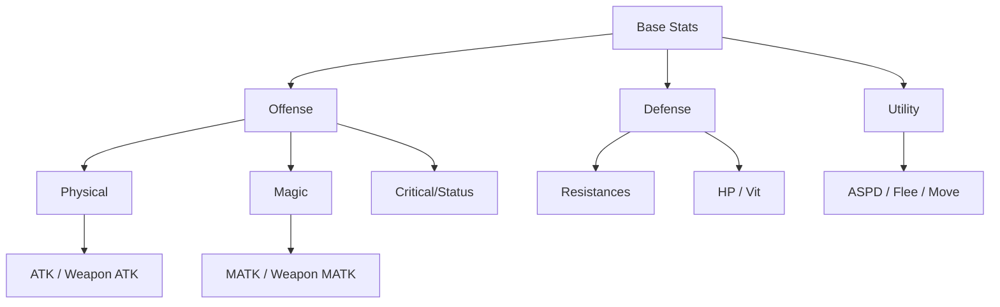

# Project Status Snapshot
*Generated on: 2026-03-15*

This snapshot provides a bird's-eye view of the current project state, focusing on data structures and system relationships.

## 1. Attribute Hierarchy
The following diagram shows the core attribute categories and their relationships.

## 2. Data Health Check
*Use the Mobility Assistant in Unity to refresh this section.*

<!-- health-start -->
- **Attribute References**: ✅ OK
- **Skill References**: ✅ OK
<!-- health-end -->

- **Item Rarity Balance**:
<!-- rarity-start -->
  - Common: 45
  - Epic: 34
  - Rare: 34
  - Uncommon: 28
  - Legendary: 26
<!-- rarity-end -->

## 3. System Overview

### Item System
Current implementation supports 6 item types: `Currency`, `Consumable`, `Equipment`, `Fragment`, `Resource`, `SkillRune`.
- **Mobility**: Item data is successfully decoupled from Unity Scenes via JSON.

### Combat & Scaling
The `ScalingBonusEffect` system allows for complex late-game scaling.
- **Example**: Chrono Pendant (Every 50 DEX/INT reduce cast time).

---
> [!TIP]
> Use the `Assets/Script/Editor/ProjectMobilityAssistant.cs` tool to keep this document up to date.
